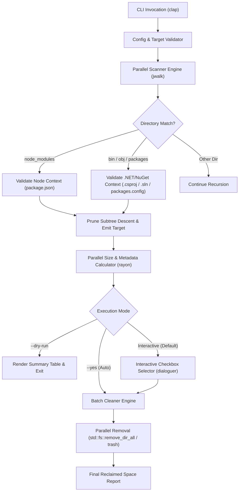

# `clicleaner` — Rust CLI Artifact & Package Cleaner Design

> [!IMPORTANT]
> **Technology Stack Selection: Rust (`edition = "2021"` / `"2024"`)**
> Rust is selected as the core implementation language for `clicleaner`. Filesystem traversal across hundreds of thousands of small files (typical of `node_modules` and NuGet caches) is heavily I/O- and syscall-bound. Rust provides zero-cost abstractions, fearless concurrency via work-stealing thread pools, native cross-platform single-binary distribution, and memory safety without garbage-collection pauses.

---

## 1. Executive Summary & Goals

Developers accumulate gigabytes of redundant external dependencies and compiled build artifacts across local repositories over time. `clicleaner` is a fast, safe, and ergonomic command-line utility written in **Rust** that scans a target directory tree, identifies **Node.js (`node_modules`)** and **.NET / NuGet (`bin`, `obj`, `packages`)** folders, calculates reclaimable disk space in parallel, and removes them either interactively or in automated batch mode.

### Core Objectives
1. **Blazing Fast Traversal**: Utilize multi-threaded directory walking and short-circuit pruning (never recursing *inside* a matched `node_modules` folder to find nested `node_modules`, saving 95%+ of syscalls).
2. **Context-Aware Target Detection**: Distinguish legitimate .NET/NuGet `bin`, `obj`, and `packages` folders from source-controlled application scripts (e.g., a Node or shell project's `./bin` directory) by validating project markers (`.csproj`, `.fsproj`, `.vbproj`, `.sln`, `packages.config`).
3. **Safety First**: Support `--dry-run` previews, age-based filtering (`--older-than 30d`), interactive multi-select confirmation, and OS Trash support (`--trash`) alongside permanent parallel deletion.

---

## 2. Why Rust?

| Requirement | Rust Advantage | Recommended Crate |
| :--- | :--- | :--- |
| **High-Speed Directory Walking** | Parallel work-stealing directory traversal (`readdir` / `stat` parallelization) | [`jwalk`](https://crates.io/crates/jwalk) or [`ignore`](https://crates.io/crates/ignore) |
| **Parallel Size & Deletion** | Data parallelism across CPU cores for summing file sizes and unlinking deep trees | [`rayon`](https://crates.io/crates/rayon) |
| **Type-Safe CLI Parsing** | Derive-based subcommands, flags, shell completions, and help generation | [`clap`](https://crates.io/crates/clap) (`derive`) |
| **Terminal UI & Progress** | Non-blocking spinners, progress bars, and interactive checkbox selection | [`indicatif`](https://crates.io/crates/indicatif) & [`dialoguer`](https://crates.io/crates/dialoguer) |
| **Safe Trash Option** | Cross-platform support for moving items to macOS Trash / Windows Recycle Bin | [`trash`](https://crates.io/crates/trash) |
| **Human-Readable Formatting** | Formatting byte counts (`1.42 GB`), durations (`45 days ago`), and colored tables | [`humansize`](https://crates.io/crates/humansize) & [`comfy-table`](https://crates.io/crates/comfy-table) |

---

## 3. System Architecture & Workflow



---

## 4. Target Detection & Safety Rules

> [!WARNING]
> **Critical Safety Invariant: `.NET` `bin` vs. Generic `bin` Folders**
> Deleting every directory named `bin` indiscriminately can destroy source-controlled executable scripts (e.g., `./bin/deploy.sh` in web or systems projects). `clicleaner` **must** verify parent/sibling project markers before flagging a `bin`, `obj`, or `packages` folder.

### Detection Heuristics

| Target Type | Directory Name(s) | Required Context Marker (Parent or Ancestor) | Subtree Pruning |
| :--- | :--- | :--- | :--- |
| **Node.js Packages** | `node_modules` | Sibling `package.json`, `pnpm-lock.yaml`, `yarn.lock`, or `package-lock.json` (configurable via `--strict`) | **Yes** — Immediately stop recursing into `node_modules` once matched |
| **NuGet / .NET Build Output** | `bin`, `obj` | Sibling `*.csproj`, `*.fsproj`, `*.vbproj`, or `project.json` in the immediate parent directory | **Yes** — Do not recurse further into `bin/` or `obj/` |
| **NuGet Solution Packages** | `packages` | Sibling `*.sln`, `nuget.config`, or child subdirectories matching `<Package>.<Version>/*.nupkg` | **Yes** — Do not recurse further into `packages/` |

### Protected Paths & Exclusions
- Never traverse system directories (`/System`, `/usr`, `/bin`, `/sbin`, `/Library`, `C:\Windows`, `C:\Program Files`).
- Skip hidden VCS directories (`.git`, `.hg`, `.svn`) automatically during traversal.
- Respect user-defined `--exclude <GLOB>` patterns (e.g., `--exclude "**/vendor/**"`).

---

## 5. CLI Interface Specification

### Command Syntax

```bash
clicleaner [OPTIONS] <TARGET_PATH>
```

### Flags & Options

| Flag / Option | Short | Default | Description |
| :--- | :--- | :--- | :--- |
| `<TARGET_PATH>` | — | `.` (Current Dir) | Root directory path to scan for cleanable artifacts |
| `--target <TYPES>` | `-t` | `all` | Comma-separated targets: `node`, `nuget`, `all` (`node_modules`, `bin`, `obj`, `packages`) |
| `--include-obj` | — | `true` | Include .NET `obj/` directories alongside `bin/` and NuGet `packages/` |
| `--dry-run` | `-d` | `false` | Scan and display reclaimable space without deleting anything |
| `--interactive` | `-i` | `true` (if TTY) | Present an interactive multi-select list of discovered folders before deleting |
| `--yes` | `-y` | `false` | Skip confirmation prompts and delete all matched targets immediately |
| `--older-than <DURATION>` | `-o` | None | Only target projects not modified within duration (e.g., `30d`, `2w`, `6m`) |
| `--trash` | — | `false` | Move directories to OS Trash / Recycle Bin instead of permanent `rm -rf` |
| `--threads <N>` | `-j` | CPU core count | Number of worker threads for scanning and deletion |
| `--json` | — | `false` | Emit structured JSON output for scripting and CI/CD pipelines |

### Example Usage Scenarios

```bash
# 1. Interactive scan of your development workspace (default: node_modules + NuGet bin/obj/packages)
clicleaner ~/Documents/development

# 2. Dry-run preview showing sizes sorted largest-first
clicleaner ~/Documents/development --dry-run

# 3. Automatically purge all node_modules and NuGet bin folders older than 30 days
clicleaner ~/Documents/development --older-than 30d --yes

# 4. Target only NuGet / .NET artifacts and move them to macOS Trash
clicleaner ~/Documents/development --target nuget --trash
```

### Sample Console Output

```text
🔍 Scanning /Users/seanrafferty/Documents/development ...
✔ Found 6 cleanable directories across 4 projects in 380ms

┌────┬──────────────┬───────────┬───────────────┬────────────────────────────────────────────────────────┐
│ #  │ Ecosystem    │ Kind      │ Last Modified │ Path                                      Size         │
├────┼──────────────┼───────────┼───────────────┼────────────────────────────────────────────────────────┤
│ 1  │ Node.js      │ modules   │ 42 days ago   │ ./webapp-portal/node_modules              842.1 MB     │
│ 2  │ Node.js      │ modules   │ 19 days ago   │ ./mobile-client/node_modules              512.4 MB     │
│ 3  │ .NET / NuGet │packages   │ 85 days ago   │ ./BillingService/packages                 318.9 MB     │
│ 4  │ .NET / NuGet │ bin       │ 12 days ago   │ ./BillingService/src/Api/bin              124.6 MB     │
│ 5  │ .NET / NuGet │ obj       │ 12 days ago   │ ./BillingService/src/Api/obj               68.2 MB     │
│ 6  │ .NET / NuGet │ bin       │ 64 days ago   │ ./AuthMicroservice/Auth.Core/bin           44.8 MB     │
└────┴──────────────┴───────────┴───────────────┴────────────────────────────────────────────────────────┘
Total reclaimable space: 1.91 GB

? Select directories to delete [Space to toggle, Enter to confirm]:
  [x] ./webapp-portal/node_modules (842.1 MB)
  [x] ./BillingService/packages (318.9 MB)
  [x] ./BillingService/src/Api/bin (124.6 MB)
  [x] ./BillingService/src/Api/obj (68.2 MB)

🗑️  Deleting 4 directories... [████████████████████████████████] 4/4 (0.4s)
✨ Done! Reclaimed 1.35 GB of disk space.
```

---

## 6. Project Structure & Core Data Models

### Directory Layout

```text
clicleaner/
├── Cargo.toml
├── DESIGN.md
└── src/
    ├── main.rs          # Entrypoint, CLI initialization, exit codes
    ├── cli.rs           # clap argument structs & validation
    ├── scanner/
    │   ├── mod.rs       # Parallel directory walker (jwalk) & subtree pruning
    │   ├── rules.rs     # Context validators for Node.js and .NET/NuGet
    │   └── size.rs      # Parallel directory byte-size & mtime computation
    ├── cleaner.rs       # Parallel deletion engine (fs::remove_dir_all / trash)
    ├── ui.rs            # Table rendering, progress bars, interactive prompts
    └── error.rs         # Unified error types (thiserror / anyhow)
```

### Key Rust Data Structures

```rust
use std::path::PathBuf;
use std::time::SystemTime;

#[derive(Debug, Clone, Copy, PartialEq, Eq, serde::Serialize)]
pub enum ArtifactKind {
    NodeModules,
    DotNetBin,
    DotNetObj,
    NuGetPackages,
}

#[derive(Debug, Clone, serde::Serialize)]
pub struct CleanTarget {
    pub path: PathBuf,
    pub kind: ArtifactKind,
    pub size_bytes: u64,
    pub file_count: u64,
    pub last_modified: Option<SystemTime>,
}

#[derive(Debug, Default)]
pub struct CleanupReport {
    pub deleted_targets: Vec<CleanTarget>,
    pub failed_targets: Vec<(PathBuf, String)>,
    pub total_bytes_freed: u64,
}
```

### Recommended `Cargo.toml`

```toml
[package]
name = "clicleaner"
version = "0.1.0"
edition = "2021"
description = "Fast CLI utility to scan and clean node_modules and .NET/NuGet bin, obj, and packages folders"

[dependencies]
anyhow = "1.0"
clap = { version = "4.5", features = ["derive"] }
comfy-table = "7.1"
console = "0.15"
dialoguer = "0.11"
humantime = "2.1"
humansize = "2.1"
indicatif = { version = "0.17", features = ["rayon"] }
jwalk = "0.8"
rayon = "1.10"
serde = { version = "1.0", features = ["derive"] }
serde_json = "1.0"
thiserror = "1.0"
trash = "5.1"

[dev-dependencies]
assert_cmd = "2.0"
predicates = "3.1"
tempfile = "3.12"
```

---

## 7. Implementation Roadmap

1. **Phase 1 — Scaffolding & CLI Definition**: Initialize Cargo project (`cargo init`), configure `clap` CLI arguments in `src/cli.rs`, and set up error handling.
2. **Phase 2 — Context-Aware Scanner & Subtree Pruning**: Implement `jwalk` traversal in `src/scanner/` with custom `read_dir` state pruning so matched `node_modules` and verified `.NET` `bin`/`obj`/`packages` directories are never descended into during discovery.
3. **Phase 3 — Parallel Size Calculation**: Use `rayon` to compute disk usage (`blocks * 512` on Unix or logical file length) and last-modified timestamps for discovered candidate folders.
4. **Phase 4 — Interactive UI & Reporting**: Build the formatted summary table (`comfy-table`), interactive selection (`dialoguer::MultiSelect`), and live progress bars (`indicatif`).
5. **Phase 5 — Parallel Deletion & Integration Tests**: Implement permanent and `--trash` deletion with graceful permission-error recovery, plus integration tests using `tempfile` with mock Node.js and .NET project trees.
